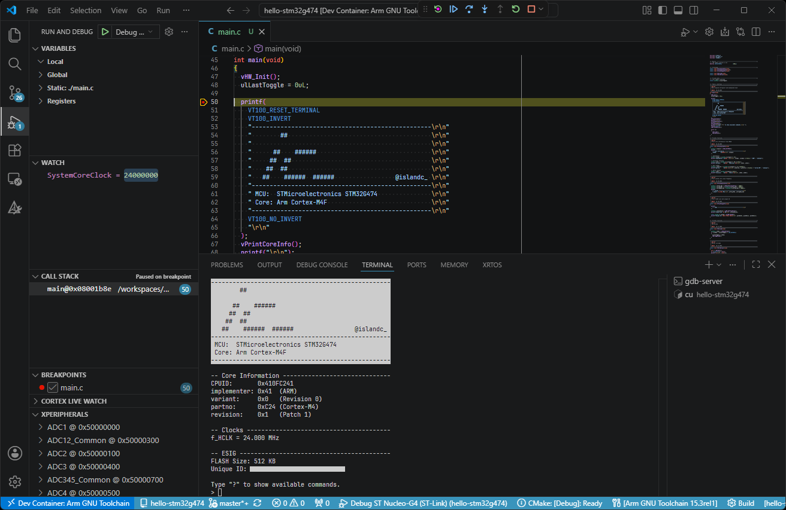

# hello-stm32g474 [](LICENSE)

A simple "Hello World"-like project for the STMicroelectronics STM32G474 MCU.

<p align="center"></p>

This project contains a simple set of modules to get the MCU running in a minimal configuration:
  - 24 MHz system clock from HSE
  - LED blinky (User LED "LD2" at pin `PA5`)
  - Debug output via ST-Link VCP (UART)

## Requirements

* Hardware
  * ST Microelectronics "[NUCLEO-G474RE](https://www.st.com/en/evaluation-tools/nucleo-g474re.html)" development board
     * *STM32 Nucleo-64* form factor
     * Featured part: *STM32G474RET6*
     * Integrated *ST-Link V3E* debugger
  * Linux OS or WSL installation
  * [Docker Engine](https://docs.docker.com/engine/install/debian/) (running within WSL if applicable)
  * VSCode [Dev Containers](https://marketplace.visualstudio.com/items?itemName=ms-vscode-remote.remote-containers) extension
  * (WSL only) [usbipd-win](https://learn.microsoft.com/en-us/windows/wsl/connect-usb)

## Usage

* Clone this repository using the following command. Note the use of the `--recursive` tag.
  ```
  git clone --recursive https://github.com/islandcontroller/hello-stm32g474
  ```
* Open the folder in VSCode
* Connect Nucleo-G474RE board using debugger USB port
  * (WSL only) attach to WSL using `usbipd attach --wsl -i 0483:374e`. **This needs to be completed before starting the Dev Container.**
* Run the command "**Dev Containers: Reopen in Container**"
  * Check if the debug probe is recognised as a connected USB device by running `lsusb`.
  * On first launch, you may need to install some udev rules on your host machine. Copy the files to your workspace by running `setup-devcontainer` inside the container.
  * Re-open the workspace on your host and run the `install-rules` script inside the `.vscode/setup` folder.

        cd .vscode/setup
        sudo ./install-rules

  * Afterwards, restart the devcontainer.
* If prompted, select the "`Arm GNU Toolchain x.x`" CMake Kit.
* Run "**CMake: Configure**"
* Build using "**CMake: Build [F7]**"
* Start debugging using "**Debug: Start Debugging [F5]**"
* Continue execution once the breakpoint in `main()` is reached.

### Serial console

The integrated ST-Link debugger provides a VCP interface. Use the `cu` utility to open a connection in a "*Terminal*" tab (115200 Baud, `8N1`):

    cu -l /dev/ttyACM0 -s 115200

**To close the connection later on, press ESC/ENTER, type `~.` (tilde, dot) and wait for 3 seconds.**

## Licensing

If not stated otherwise in the specific file, the contents of this project are licensed under the MIT License. The full license text is provided in the [`LICENSE`](LICENSE) file.

    SPDX-License-Identifier: MIT
